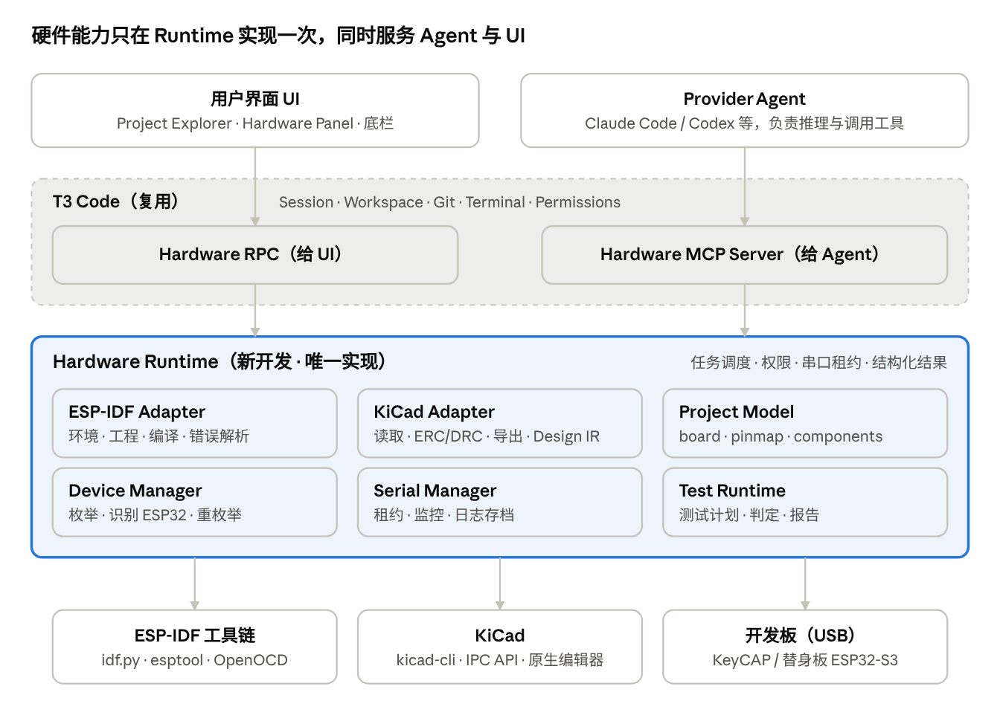
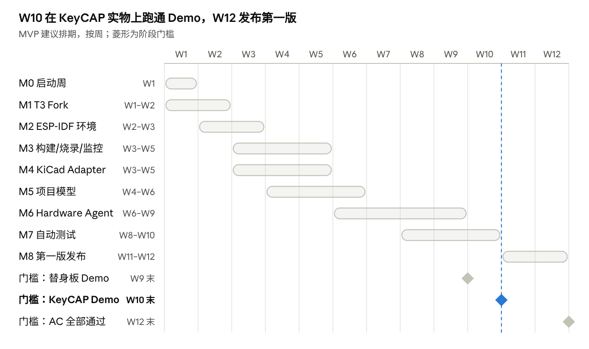

# AI Hardware Studio MVP 需求规格说明书

2026-11-05 · DeDe · 在线版：https://claude.ai/artifact/PZaRxAimVbQVcxdxVs2cLh

## 目录

1. [文档信息](#1-文档信息)
2. [产品概述](#2-产品概述)
3. [范围](#3-范围)
4. [系统架构](#4-系统架构)
5. [功能需求清单](#5-功能需求清单)
6. [数据模型](#6-数据模型)
7. [Agent 工具接口与权限矩阵](#7-agent-工具接口与权限矩阵)
8. [非功能需求](#8-非功能需求)
9. [参考硬件需求（KeyCAP）与替身板](#9-参考硬件需求keycap与替身板)
10. [验收标准](#10-验收标准)
11. [里程碑、Epic 与团队分工](#11-里程碑epic-与团队分工)
12. [风险与待决策事项](#12-风险与待决策事项)

## 1. 文档信息

本文档是 AI Hardware Studio 第一版 MVP 的需求基线，供产品、平台、嵌入式、EDA、AI、硬件六类角色共同使用。后续《软件架构与 API 规范》《KeyCAP 硬件设计规范》均以此为上游。

| 项目         | 内容                                                                                        |
| ------------ | ------------------------------------------------------------------------------------------- |
| 版本         | v0.1 草案                                                                                   |
| 适用范围     | 第一版 MVP（ESP32-S3 + ESP-IDF + KiCad，基于 T3 Code Fork）                                 |
| 需求编号规则 | FR-模块-序号（功能），NFR-序号（非功能），AC-序号（验收），Q-序号（待决策），R-序号（风险） |
| 优先级定义   | P0 = Demo 主链路必需；P1 = AI 硬件开发能力；P2 = 差异化能力，可延后                         |

**术语**

| 术语               | 含义                                                                      |
| ------------------ | ------------------------------------------------------------------------- |
| T3 Code            | 开源 Coding Agent 控制面（桌面端 + Server），本产品的 Fork 基础           |
| Provider Agent     | T3 托管的底层 Agent（如 Claude Code、Codex），负责实际推理与工具调用      |
| Hardware Runtime   | 本产品新开发的运行时：管理工具链、设备、串口、测试任务                    |
| Hardware API       | Runtime 对外的唯一能力接口，以 MCP（给 Agent）和 RPC（给 UI）两种形式暴露 |
| Hardware Project   | 包含电路、PCB、固件、测试、文档的统一项目目录                             |
| Hardware Design IR | 电路设计中间表示，自然语言需求与 KiCad 文件之间的结构化层                 |
| 串口租约           | 对单个串口的独占使用权，同一时刻只属于一个使用者                          |
| KeyCAP             | 第一代参考开发板的项目代号（待确认，见 Q-01）                             |
| 替身板             | KeyCAP 回板前使用的现成 ESP32-S3 开发板 + IMU 模块                        |

## 2. 产品概述

AI Hardware Studio 是一个以 AI Agent 为核心、能同时操作电路工程和嵌入式固件工程的桌面硬件开发环境。它不取代 KiCad、VS Code 或 ESP-IDF，而是把它们整合起来，让 AI 能理解、操作并在真实硬件上验证项目。

**核心体验**：用户提出一个硬件需求，AI 读取对应的板卡与电路，创建 ESP-IDF 固件工程，完成编译、烧录、串口监控，并根据实际运行结果继续修改；同时能管理、检查和有限度地修改 KiCad 工程。

**一句话成功标准**：用户拿到 KeyCAP 开发板，安装 AI Hardware Studio，就能通过 AI 完成 ESP-IDF 固件开发、KiCad 工程管理、编译烧录和真实硬件验证。

**MVP 对外承诺口径**（统一版本，消除原方案中的矛盾）：

- AI 理解硬件配置（板卡、引脚、外设）。
- AI 完成固件闭环：写代码 → 编译 → 修复 → 烧录 → 读串口 → 验证。
- AI 管理和检查 KiCad 工程（读取、ERC/DRC、导出生产文件、受控的基础修改）。
- **不承诺**：AI 自主生成完整原理图、自动布局布线。

**目标用户**

| 用户                     | 场景                                   | 第一版重点     |
| ------------------------ | -------------------------------------- | -------------- |
| 嵌入式/硬件工程师        | 用 AI 加速 ESP32 固件开发与板级调试    | 是             |
| KeyCAP 开发板用户 / 创客 | 开箱即用，用自然语言完成外设驱动和测试 | 是             |
| 内部团队                 | 用此工具开发和验证 KeyCAP 自身         | 是（第一用户） |
| 专业 PCB 设计师          | AI 辅助复杂电路与布局                  | 否，后续版本   |

## 3. 范围

MVP 只支持 ESP32-S3 + ESP-IDF + KiCad 这一组合，重心是“硬件配置 → 固件 → 真实设备验证”的闭环。

| 功能                                       | 第一版               | 优先级 |
| ------------------------------------------ | -------------------- | ------ |
| T3 Code 桌面环境、Agent 对话与 Coding      | 必须                 | P0     |
| ESP-IDF 环境检测与配置                     | 必须                 | P0     |
| ESP32-S3 工程创建、Build / Flash / Monitor | 必须                 | P0     |
| USB / UART 设备管理                        | 必须                 | P0     |
| KiCad 工程管理、原理图与 PCB 读取          | 必须                 | P0     |
| ERC / DRC 自动检查                         | 必须                 | P0     |
| BOM / Gerber / Drill 导出                  | 必须                 | P0     |
| Agent 理解硬件、写固件、修编译错误         | 必须                 | P1     |
| AI 修改原理图                              | 基础能力（受控修改） | P1     |
| AI 分析 PCB / DRC 报告                     | 辅助能力（只给建议） | P1     |
| 自动化硬件测试（至少 IMU 一个外设）        | 必须（Demo 需要）    | P1     |
| AI 自动生成原理图                          | 不作验收             | P2     |
| AI 自动布局布线                            | 不作验收             | P2     |
| 用户自定义模块与参考设计                   | 不做                 | P2     |

**明确不做**：自研 EDA、自研编译器、自研 Agent Harness、在线 PCB 编辑器、嵌入 KiCad 编辑器、多 MCU（ESP32-S3 之外）、移动端、Linux 安装包。

**关键假设**

1. T3 Code 的许可证允许 Fork 和商业使用，且 Provider Agent 支持接入自定义 MCP Server。
2. 用户已有或可通过本软件安装 ESP-IDF 与 KiCad，版本在支持范围内。
3. 用户自备模型 Provider 账号（如 Claude Code / Codex）。
4. KeyCAP 实物板回板前，用替身板开发和演示。

## 4. 系统架构

架构分五层：硬件能力只在 Hardware Runtime 实现一次，再同时以 MCP Server（给 Provider Agent）和 Hardware RPC（给 UI）两种形式暴露。这就是“Agent 与 UI 调用同一套 Hardware API”原则的落地方式。



UI 与 Agent 走不同入口，但落到同一个 Runtime；外部工具和设备只被 Runtime 访问，因此权限和串口租约只需在一处执行。

**T3 复用与新增边界**

| T3 原有模块                                                                     | 处理方式                                       |
| ------------------------------------------------------------------------------- | ---------------------------------------------- |
| Agent Session、Provider Adapter、Workspace、Terminal、Git / Checkpoint、Desktop | 直接复用                                       |
| MCP                                                                             | 复用，挂载 Hardware MCP Server                 |
| Permission System                                                               | 复用并扩展硬件权限（烧录、擦除、硬件工程修改） |
| Client Runtime / RPC                                                            | 扩展 Hardware RPC                              |
| Mobile                                                                          | 第一版不开发                                   |

**架构约束**

- 硬件业务逻辑全部放在 `packages/hardware-*`，不进入 T3 Server 核心，以降低与上游同步的冲突。
- 所有外部工具（idf.py、esptool、kicad-cli）只由 Runtime 调用，统一管理进程、超时、取消和日志流。
- 所有工具返回结构化 JSON，而不是原始终端文本。

**建议代码目录**（是否拆为独立发布包，待仓库依赖审计后确定）

```text
t3code/
├── apps/            desktop / server / web
├── packages/
│   ├── contracts/  client-runtime/  provider-core/   (T3 原有)
│   ├── hardware-core/        公共类型、错误码、任务模型
│   ├── hardware-project/     项目模型与 Schema 校验
│   ├── hardware-runtime/     任务调度、MCP Server、RPC 入口
│   ├── hardware-esp-idf/     ESP-IDF Adapter
│   ├── hardware-kicad/       KiCad Adapter 与 Design IR
│   ├── hardware-serial/      串口与租约
│   ├── hardware-device/      设备枚举与识别
│   ├── hardware-test/        测试计划、执行、报告
│   └── hardware-agent/       Agent 提示词、上下文构建、工具描述
└── examples/        esp32-blink / esp32-imu / keycap-reference-board
```

## 5. 功能需求清单

共 9 个模块、按编号列出；每条需求都带优先级和可检验的验收要点，可直接拆成 Issue。

### 5.1 平台（PLT）

| 编号      | 需求                                            | 优先级 | 验收要点                                |
| --------- | ----------------------------------------------- | ------ | --------------------------------------- |
| FR-PLT-01 | Fork T3 Code，桌面端可构建、安装、启动          | P0     | macOS 安装包可启动并开启 Agent 会话     |
| FR-PLT-02 | 品牌替换为 AI Hardware Studio，增加硬件项目入口 | P0     | 启动页可新建 / 打开 Hardware Project    |
| FR-PLT-03 | 新增 Hardware RPC，UI 通过它调用 Runtime        | P0     | UI 可发起 build 并收到实时日志流        |
| FR-PLT-04 | Runtime 以 MCP Server 形式挂载到 Provider Agent | P0     | Agent 会话中可见并可调用 `espidf.build` |
| FR-PLT-05 | 上游同步策略与 CI（lint、类型检查、单测、打包） | P0     | 每个 PR 自动跑 CI                       |

### 5.2 项目模型（PRJ）

| 编号      | 需求                                                                                                       | 优先级 | 验收要点                                        |
| --------- | ---------------------------------------------------------------------------------------------------------- | ------ | ----------------------------------------------- |
| FR-PRJ-01 | 按规范目录新建 / 打开 Hardware Project（见第 6 节）                                                        | P0     | 新建后目录与模板一致                            |
| FR-PRJ-02 | `project.json`、`board.json`、`pinmap.json`、`components.json`、`test-plan.yaml` 有 JSON Schema 并自动校验 | P0     | 非法配置给出字段级错误                          |
| FR-PRJ-03 | 板卡配置与原理图一致性校验（引脚、网络、器件位号）                                                         | P1     | 修改原理图引脚后提示 `pinmap.json` 不一致       |
| FR-PRJ-04 | 器件数据库接口：型号、封装、采购信息、替代料                                                               | P1     | `components.json` 可记录至少 1 个采购源与替代料 |
| FR-PRJ-05 | Project Explorer 按 Hardware / Schematic / PCB / Firmware / Tests 分组显示                                 | P0     | 五类节点均可展开                                |

### 5.3 ESP-IDF 环境与构建（IDF）

| 编号      | 需求                                                                            | 优先级 | 验收要点                                     |
| --------- | ------------------------------------------------------------------------------- | ------ | -------------------------------------------- |
| FR-IDF-01 | 检测 OS、ESP-IDF 版本与路径、Python、CMake、Ninja、交叉编译器、环境变量         | P0     | 输出结构化 EnvironmentInfo，缺项逐条列出     |
| FR-IDF-02 | 一键安装或修复环境                                                              | P0     | 空白机器可装好并通过 FR-IDF-01               |
| FR-IDF-03 | 保存环境信息到 `.hardware/environment.json`                                     | P0     | 重启后无需重新检测                           |
| FR-IDF-04 | 创建 ESP32-S3 工程（可基于板卡配置生成初始 sdkconfig）                          | P0     | 新工程无改动即可编译通过                     |
| FR-IDF-05 | 执行 `idf.py build`，实时日志流、可取消、可超时                                 | P0     | 取消后无残留进程                             |
| FR-IDF-06 | 编译错误解析为结构化结果（文件、行、列、级别、消息、阶段：编译 / 链接 / CMake） | P0     | 覆盖编译错误、链接错误、CMake 配置错误三类   |
| FR-IDF-07 | 构建历史与 Build Report（耗时、固件大小、结果）                                 | P1     | `.hardware/build-history.json` 可查最近 N 次 |
| FR-IDF-08 | menuconfig 可用（终端内或结构化修改 sdkconfig）                                 | P1     | 可修改并保存一项配置                         |

### 5.4 设备与串口（DEV）

| 编号      | 需求                                                                                | 优先级 | 验收要点                                      |
| --------- | ----------------------------------------------------------------------------------- | ------ | --------------------------------------------- |
| FR-DEV-01 | 枚举 USB 串口设备，显示名称、VID、PID、路径、序列号                                 | P0     | 插拔后 2 秒内刷新                             |
| FR-DEV-02 | 识别可能的 ESP32 设备（USB-Serial/JTAG、CP210x、CH34x）并读取芯片型号               | P0     | 替身板和 KeyCAP 都能正确识别                  |
| FR-DEV-03 | 串口独占租约：acquire / release、归属方、超时自动释放                               | P0     | 用户与 Agent 同时申请时，后者得到明确占用错误 |
| FR-DEV-04 | 烧录固件，实时进度；烧录期间自动暂停监控，完成后自动恢复                            | P0     | 连续烧录 10 次无需手动重连                    |
| FR-DEV-05 | 处理 USB 重枚举（复位后端口断开或改名），按序列号重新绑定                           | P0     | 复位后监控自动恢复                            |
| FR-DEV-06 | 实时串口监控（可设波特率），日志存档到项目                                          | P0     | 日志按会话存文件，带时间戳                    |
| FR-DEV-07 | Agent 可按行数 / 时间窗 / 关键字读取日志，并识别 panic、看门狗复位、Guru Meditation | P1     | panic 日志被标记为异常并带回溯信息            |

### 5.5 KiCad（EDA）

| 编号      | 需求                                                                   | 优先级 | 验收要点                                      |
| --------- | ---------------------------------------------------------------------- | ------ | --------------------------------------------- |
| FR-EDA-01 | 检测 KiCad 安装与版本，不符合支持版本时提示                            | P0     | 输出版本号和 kicad-cli 路径                   |
| FR-EDA-02 | 用 KiCad 原生编辑器打开工程                                            | P0     | 一键打开原理图 / PCB                          |
| FR-EDA-03 | 读取原理图：器件、属性、引脚、网络连接，输出结构化结果                 | P0     | KeyCAP 原理图全部器件与网络可列出             |
| FR-EDA-04 | 读取 PCB：板框、层数、器件位置、网络、未布线状态                       | P0     | 输出未布线网络数                              |
| FR-EDA-05 | 执行 ERC / DRC，输出结构化违规列表（类型、严重级别、位置、相关对象）   | P0     | 结果与 KiCad GUI 中一致                       |
| FR-EDA-06 | 导出 BOM、Gerber、Drill、坐标文件、DRC 报告、生产文件清单              | P0     | 输出到 `manufacturing/`，可被嘉立创等工厂接受 |
| FR-EDA-07 | 3D / STEP 导出                                                         | P1     | 可生成 STEP 文件                              |
| FR-EDA-08 | 受控原理图修改：经 Design IR 生成修改计划 → 用户确认 → 写入 → 自动 ERC | P1     | 增加一个 I2C 外设后 ERC 无新增错误            |
| FR-EDA-09 | PCB 布局与走线修改建议（只读分析）                                     | P1     | 对 DRC 问题给出可执行建议                     |
| FR-EDA-10 | 自然语言生成原理图、辅助布局布线                                       | P2     | 不作 MVP 验收                                 |

### 5.6 Hardware Agent（AGT）

| 编号      | 需求                                                           | 优先级 | 验收要点                                       |
| --------- | -------------------------------------------------------------- | ------ | ---------------------------------------------- |
| FR-AGT-01 | 单一主 Agent + 硬件工具集（不拆多个独立 Agent）                | P1     | 工具清单见第 7 节                              |
| FR-AGT-02 | 项目理解：会话开始时自动注入板卡、引脚、外设、环境摘要         | P1     | Agent 能正确回答“IMU 接在哪个 I2C、地址是多少” |
| FR-AGT-03 | 按板卡配置编写 ESP-IDF 固件（驱动、任务、日志格式）            | P1     | 生成代码使用配置中的引脚，而非硬编码           |
| FR-AGT-04 | 编译→分析→修复→重编译闭环，有最大重试次数                      | P1     | 至少一类真实编译错误可自动修复                 |
| FR-AGT-05 | 烧录后读串口并分析异常（panic、初始化失败、数据异常）          | P1     | 能根据 I2C 初始化失败日志定位原因              |
| FR-AGT-06 | 读取原理图与 ERC/DRC 报告并解释                                | P1     | 能对每条 ERC 错误说明原因                      |
| FR-AGT-07 | 硬件工程修改产生 Diff，可查看、可回滚（基于 Git / Checkpoint） | P1     | 任意一次修改可一键回滚                         |
| FR-AGT-08 | Agent 不得绕过 Hardware API 直接调用烧录 / 擦除命令            | P0     | 终端直接执行 `idf.py flash` / `esptool` 被拦截 |

### 5.7 自动测试（TST）

| 编号      | 需求                                                          | 优先级 | 验收要点                          |
| --------- | ------------------------------------------------------------- | ------ | --------------------------------- |
| FR-TST-01 | 标准 Board Test Firmware：电源、I2C 扫描、IMU 自检、GPIO 回环 | P1     | 在替身板与 KeyCAP 上均可运行      |
| FR-TST-02 | 测试计划 `test-plan.yaml`：用例、判定规则、超时               | P1     | 规则可机器执行                    |
| FR-TST-03 | 固件串口输出采用机器可解析格式（JSON Lines）                  | P1     | 解析失败率为 0                    |
| FR-TST-04 | 执行测试：编译 → 烧录 → 采集 → 按规则判定                     | P1     | 输出每条用例 pass / fail 及实测值 |
| FR-TST-05 | 生成测试报告（Markdown + JSON），包含设备、固件版本、判定详情 | P1     | 报告存到 `tests/` 下              |

### 5.8 用户界面（UI）

| 编号     | 需求                                                                            | 优先级 | 验收要点                        |
| -------- | ------------------------------------------------------------------------------- | ------ | ------------------------------- |
| FR-UI-01 | 三栏布局：左 Project Explorer、中 Agent Workspace + 代码编辑、右 Hardware Panel | P0     | 保留 T3 原有交互风格            |
| FR-UI-02 | 底部面板：Terminal / Build Output / Serial Monitor / ERC-DRC                    | P0     | 四个标签可切换且实时更新        |
| FR-UI-03 | Hardware Panel：板卡信息、器件、引脚映射、已连接设备                            | P0     | 显示当前串口租约归属            |
| FR-UI-04 | 顶部栏：Project / Devices / Build 快捷操作                                      | P0     | 一键 Build / Flash / Monitor    |
| FR-UI-05 | Schematic / PCB 视图：文件预览（SVG/PDF 导出）、启动 KiCad、检查报告            | P0     | 无需打开 KiCad 即可看原理图     |
| FR-UI-06 | Tests 视图：测试计划与历史结果                                                  | P1     | 可查看历史报告                  |
| FR-UI-07 | 首次启动向导：环境检测、Provider 登录、示例项目                                 | P0     | 新用户 15 分钟内跑通 blink 示例 |

界面布局示意：

```text
┌──────────────────────────────────────────────────────┐
│ AI Hardware Studio        Project     Devices   Build │
├──────────────┬───────────────────────┬───────────────┤
│ Project      │                       │ Hardware      │
│ Explorer     │    Agent Workspace    │ Panel         │
│              │                       │               │
│ Hardware     │    Coding Agent       │ Board Info    │
│ Schematic    │                       │ Components    │
│ PCB          │    Code Editor        │ Pin Mapping   │
│ Firmware     │                       │ Devices       │
│ Tests        │                       │               │
├──────────────┴───────────────────────┴───────────────┤
│ Terminal  | Build Output | Serial Monitor | ERC/DRC  │
└──────────────────────────────────────────────────────┘
```

### 5.9 权限（PRM）

| 编号      | 需求                                           | 优先级 | 验收要点                         |
| --------- | ---------------------------------------------- | ------ | -------------------------------- |
| FR-PRM-01 | 按第 7 节权限矩阵执行确认 / 授权               | P0     | 烧录前弹出确认，含端口与固件信息 |
| FR-PRM-02 | 权限在 Runtime 层强制执行，而非只在 UI 提示    | P0     | 绕过 UI 直接调用 MCP 仍需确认    |
| FR-PRM-03 | 修改固件前自动创建 Checkpoint                  | P0     | 每次 Agent 改动可回退            |
| FR-PRM-04 | 授权记录可审计（谁、何时、对哪个设备做了什么） | P1     | 日志可导出                       |

## 6. 数据模型

Hardware Project 是 AI 理解硬件的统一入口；原理图是电气连接的权威来源，`board.json` / `pinmap.json` 由它导出或与它校验，不允许两边各自演化。

**项目目录规范**

```text
MyHardwareProject/
├── project.json              项目元信息、工具版本、子目录索引
├── hardware/
│   ├── board.json            MCU、接口、外设
│   ├── pinmap.json           引脚 → 网络 → 功能
│   ├── components.json       器件、封装、采购、替代料
│   ├── schematic/            *.kicad_pro / *.kicad_sch / libraries/
│   ├── pcb/                  *.kicad_pcb / footprints/
│   └── bom/
├── firmware/                 ESP-IDF 工程（CMakeLists.txt、sdkconfig、main/、components/）
├── tests/                    hardware/ firmware/ test-plan.yaml reports/
├── docs/                     README.md schematic.md pinout.md
├── manufacturing/            gerber/ drill/ 坐标文件 生产清单
└── .hardware/                environment.json device.json build-history.json agent-context.json
```

**文件职责与来源**

| 文件                           | 内容                                                          | 来源                       | 是否入 Git     |
| ------------------------------ | ------------------------------------------------------------- | -------------------------- | -------------- |
| `project.json`                 | 项目 ID、名称、目标芯片、ESP-IDF / KiCad 版本要求             | 人工 / 新建向导            | 是             |
| `board.json`                   | MCU 型号、接口（I2C/UART/SPI 引脚）、外设（类型、接口、地址） | 从原理图导出，人工补充语义 | 是             |
| `pinmap.json`                  | GPIO → 网络名 → 功能 → 电气约束                               | 从原理图导出               | 是             |
| `components.json`              | 位号、型号、封装、制造商、采购编号、替代料、数据手册链接      | 原理图 + 器件库            | 是             |
| `tests/test-plan.yaml`         | 用例、判定规则、超时                                          | 人工 / Agent 生成          | 是             |
| `.hardware/environment.json`   | 本机工具链路径与版本                                          | 自动检测                   | 否（本机数据） |
| `.hardware/device.json`        | 最近使用的设备与端口                                          | 自动                       | 否             |
| `.hardware/build-history.json` | 构建记录                                                      | 自动                       | 否             |
| `.hardware/agent-context.json` | Agent 上下文摘要缓存                                          | 自动                       | 否             |

**`board.json` 示例**（引脚与地址仅为格式示意，以最终原理图和数据手册为准）

```json
{
  "schema_version": "0.1",
  "board_id": "keycap_v1",
  "name": "KeyCAP Development Board",
  "mcu": { "vendor": "Espressif", "model": "ESP32-S3" },
  "interfaces": {
    "i2c": [{ "name": "I2C0", "sda": 8, "scl": 9 }],
    "uart": [{ "name": "UART0", "tx": 43, "rx": 44 }]
  },
  "peripherals": [
    {
      "name": "IMU",
      "type": "sensor",
      "interface": "I2C0",
      "address": "0x68",
      "part": "U3",
      "test": "imu_basic"
    }
  ]
}
```

**数据规则**

1. 所有配置文件带 `schema_version`，Runtime 加载时校验，升级时自动迁移。
2. 原理图变更后触发一致性校验（FR-PRJ-03）；不一致时阻止 Agent 基于旧配置生成代码。
3. Hardware Design IR 是原理图修改的中间层：需求 → IR → 器件与网络校验 → 写入 KiCad → ERC → 用户确认；写入后重新导出 `board.json` / `pinmap.json`。

## 7. Agent 工具接口与权限矩阵

第一版开放 29 个工具，全部由 Hardware Runtime 实现、通过 MCP 暴露；UI 按钮调用的是同一组接口。

| 分组    | 工具                                                                                                                      | 默认权限                          |
| ------- | ------------------------------------------------------------------------------------------------------------------------- | --------------------------------- |
| 项目    | `hardware.project.inspect` `hardware.project.read_board` `hardware.project.read_pinmap` `hardware.project.get_components` | 自动允许                          |
| ESP-IDF | `espidf.detect_environment` `espidf.get_build_errors`                                                                     | 自动允许                          |
| ESP-IDF | `espidf.create_project` `espidf.build` `espidf.menuconfig`                                                                | 自动允许（修改前自动 Checkpoint） |
| ESP-IDF | `espidf.flash`                                                                                                            | 用户确认                          |
| ESP-IDF | `espidf.monitor`                                                                                                          | 自动允许（需持有串口租约）        |
| 设备    | `device.list` `device.get_info`                                                                                           | 自动允许                          |
| 设备    | `device.acquire` `device.release`                                                                                         | 自动允许（受租约规则约束）        |
| 串口    | `serial.open` `serial.read` `serial.close`                                                                                | 自动允许（需持有租约）            |
| KiCad   | `kicad.open_project` `kicad.read_schematic` `kicad.read_pcb`                                                              | 自动允许                          |
| KiCad   | `kicad.run_erc` `kicad.run_drc` `kicad.export_bom` `kicad.export_gerber`                                                  | 自动允许                          |
| KiCad   | `kicad.modify_schematic`                                                                                                  | 用户确认修改计划后执行            |
| 测试    | `hardware.test.run`                                                                                                       | 含烧录步骤时需用户确认            |
| 测试    | `hardware.test.get_result` `hardware.test.generate_report`                                                                | 自动允许                          |

**操作权限矩阵**

| 操作                    | 默认权限                                               |
| ----------------------- | ------------------------------------------------------ |
| 读取原理图 / PCB / 配置 | 自动允许                                               |
| 修改固件代码            | 自动允许，修改前创建 Checkpoint                        |
| 编译固件                | 自动允许                                               |
| 修改原理图 / PCB        | 先展示修改计划与 Diff，用户确认后执行                  |
| 烧录设备                | 每次用户确认（可在会话内对同一设备授权“本会话内允许”） |
| 擦除 Flash、写 eFuse    | 必须逐次明确授权；eFuse 第一版不开放                   |
| 控制电机或高功率设备    | 必须逐次明确授权                                       |

**接口通用要求**

- 所有长任务（build、flash、test）返回任务 ID，支持进度事件、取消和超时。
- 错误统一为 `{code, message, detail, retryable}`，错误码在 `hardware-core` 集中定义。
- 编译结果示例：`{"success": false, "errors": [{"file": "main/main.c", "line": 32, "stage": "link", "message": "undefined reference"}]}`。
- 为防止 Agent 绕过权限，Provider 终端中的 `idf.py flash`、`idf.py erase-flash`、`esptool` 等命令通过命令拦截拒绝，并提示改用对应工具。

**ESP-IDF Adapter 接口草案**（正式代码还需定义进程取消、超时、日志流和错误类型）

```ts
interface ESPIDFAdapter {
  detectEnvironment(): Promise<EnvironmentInfo>;
  createProject(config: ProjectConfig): Promise<ProjectResult>;
  build(projectPath: string): Promise<BuildResult>;
  flash(projectPath: string, port: string): Promise<FlashResult>;
  monitor(port: string, baudRate: number): Promise<MonitorSession>;
  getBuildErrors(buildId: string): Promise<BuildError[]>;
}
```

## 8. 非功能需求

非功能需求以“真实硬件上稳定可用”为核心，重点在进程与串口的可靠性。各项数值为建议目标，待第一周评审确认。

| 编号   | 类别     | 要求                                                                                               |
| ------ | -------- | -------------------------------------------------------------------------------------------------- |
| NFR-01 | 平台     | MVP 主支持 macOS（Apple Silicon）；Windows 10/11 x64 在 M8 提供安装包；Linux 不在范围内（见 Q-05） |
| NFR-02 | 工具版本 | 锁定一个 ESP-IDF 稳定版和一个 KiCad 大版本，写入 `project.json`，版本不符时明确提示（见 Q-04）     |
| NFR-03 | 可靠性   | 任何外部进程可取消、有超时；崩溃或取消后不留孤儿进程、不占用串口                                   |
| NFR-04 | 可靠性   | 串口在烧录、复位、USB 重枚举后自动恢复；连续 10 次“编译-烧录-监控”循环成功率 ≥ 95%                 |
| NFR-05 | 性能     | UI 串口日志延迟 < 200 ms；设备插拔检测 < 2 s；增量编译耗时与命令行直接执行相差 < 10%               |
| NFR-06 | 安全     | 权限在 Runtime 层强制执行；危险命令拦截；模型密钥只存系统钥匙串，不写入项目目录                    |
| NFR-07 | 数据     | 硬件工程与固件的所有修改可通过 Git / Checkpoint 回滚；本机状态放在 `.hardware/` 并默认忽略         |
| NFR-08 | 可观测性 | Runtime 结构化日志；一键导出诊断包（环境信息、日志、最近构建与串口记录，不含密钥）                 |
| NFR-09 | 离线     | 除模型调用外，编译、烧录、监控、ERC/DRC、导出均可离线完成                                          |
| NFR-10 | 可维护性 | 硬件代码不侵入 T3 核心；上游同步周期与冲突处理有文档；Runtime 单测覆盖错误解析与租约逻辑           |
| NFR-11 | 文档     | 安装指南、快速开始、示例项目说明、工具接口参考                                                     |

## 9. 参考硬件需求（KeyCAP）与替身板

KeyCAP 第一版是一块能完整验证软件工作流、且可被 AI 自动测试的 ESP32-S3 开发板；回板前用替身板保证软件不被硬件进度卡住。

**KeyCAP v1 硬件需求**

| 编号  | 功能     | 要求                                                                                | 待定项                               |
| ----- | -------- | ----------------------------------------------------------------------------------- | ------------------------------------ |
| HW-01 | MCU      | ESP32-S3                                                                            | 具体模组 / 芯片、Flash 与 PSRAM 容量 |
| HW-02 | USB      | USB-C，供电 + 数据                                                                  | 是否另加 USB-UART 桥芯片             |
| HW-03 | 调试     | 原生 USB Serial/JTAG；支持自动下载（无需按 BOOT）                                   | —                                    |
| HW-04 | 传感器   | 板载 IMU（I2C），可读 WHO_AM_I                                                      | 具体型号与 I2C 地址                  |
| HW-05 | 扩展     | I2C / UART / GPIO 排针，可插拔传感器模块                                            | 接口形式（排针 / Qwiic / 自定义）    |
| HW-06 | 电源     | USB-C 5V 输入，3.3V LDO 或 DC-DC                                                    | 电源芯片与电流余量                   |
| HW-07 | 可测性   | 关键电源与信号测试点；一个用户 LED 和一个按键供自测                                 | 测试点清单                           |
| HW-08 | 工程交付 | KiCad 原生工程、`board.json`、`pinmap.json`、`components.json`、Board Test Firmware | —                                    |
| HW-09 | 制造     | BOM 全部有采购编号与替代料；可由嘉立创等工厂 SMT                                    | 工厂与器件库策略                     |

**替身板方案**

- 硬件：现成 ESP32-S3 开发板（如乐鑫官方 ESP32-S3-DevKitC-1）+ 与 KeyCAP 同型号的 IMU 模块，用杜邦线接到与 KeyCAP 相同的 I2C 引脚。
- 配置：为替身板写一套独立的 `board.json` / `pinmap.json`，放在 `examples/esp32-imu/`。
- 切换：KeyCAP 回板后只替换配置文件，固件与测试无需改代码——这同时是对数据模型通用性的验证。
- 采购：第一周内为每位嵌入式 / Agent 开发者配至少 2 套。

## 10. 验收标准

MVP 以一条端到端 Demo 在真实硬件上跑通为最终判定；下表 15 项为分项验收，全部通过且 Demo 连续成功 3 次即视为完成。

| 编号  | 验收项   | 完成标准                              | 对应需求     |
| ----- | -------- | ------------------------------------- | ------------ |
| AC-01 | 桌面应用 | 可正常安装和启动                      | FR-PLT-01    |
| AC-02 | ESP-IDF  | 自动识别已安装环境                    | FR-IDF-01    |
| AC-03 | 工程创建 | 能创建 ESP32-S3 项目                  | FR-IDF-04    |
| AC-04 | 编译     | 完成真实编译并返回结构化结果          | FR-IDF-05/06 |
| AC-05 | 编译修复 | Agent 自动修复至少一类真实编译错误    | FR-AGT-04    |
| AC-06 | 设备识别 | 发现已连接的 ESP32-S3                 | FR-DEV-01/02 |
| AC-07 | 烧录     | 用户确认后自动烧录成功                | FR-DEV-04    |
| AC-08 | 串口     | 实时读取日志，复位后自动恢复          | FR-DEV-05/06 |
| AC-09 | KiCad    | 可打开原生工程并读出器件与网络        | FR-EDA-02/03 |
| AC-10 | ERC      | 自动执行并读取结构化结果              | FR-EDA-05    |
| AC-11 | DRC      | 自动执行并读取结构化结果              | FR-EDA-05    |
| AC-12 | BOM      | 导出带采购信息的物料清单              | FR-EDA-06    |
| AC-13 | Gerber   | 生成可提交工厂的生产文件              | FR-EDA-06    |
| AC-14 | Agent    | 同时理解硬件配置与固件项目            | FR-AGT-02/03 |
| AC-15 | 自动测试 | 完成一个真实外设（IMU）测试并生成报告 | FR-TST-01~05 |

**端到端 Demo**

用户打开 AI Hardware Studio，选择 KeyCAP 参考开发板（回板前为替身板），输入：

> 创建一个 ESP32-S3 项目，读取板载 IMU 的加速度和角速度，每隔 100ms 输出一次数据，请完成代码、编译、烧录和测试。

系统应依次完成：

1. 读取板卡配置。
2. 找到 IMU 对应的 I2C 接口与地址。
3. 生成 ESP-IDF 工程。
4. 生成 IMU 驱动代码（引脚取自配置）。
5. 编译（失败时自动修复）。
6. 用户确认后烧录。
7. 打开串口。
8. 解析数据。
9. 按下方规则验证数据有效性。
10. 输出测试报告。

**“数据有效”判定规则**（板子静止平放，连续采集 10 秒）

| 规则     | 通过条件                                                                     |
| -------- | ---------------------------------------------------------------------------- |
| 器件在线 | WHO_AM_I 读值等于数据手册规定值                                              |
| 输出格式 | 每行为合法 JSON，含 `ts`、`ax`、`ay`、`az`、`gx`、`gy`、`gz`，解析失败率为 0 |
| 采样周期 | 相邻样本间隔均值 100 ms ± 10 ms                                              |
| 加速度   | 三轴合成模长均值 1 g ± 10%                                                   |
| 角速度   | 各轴均值绝对值 < 5 °/s                                                       |
| 数据活性 | 不存在连续 10 个完全相同的样本（排除传感器卡死）                             |
| 稳定性   | 采集期间无 panic、无复位                                                     |

## 11. 里程碑、Epic 与团队分工

计划 12 周内交付可公开演示的版本：M1–M5 打通工具链底座，M6–M7 叠加 AI 与自动测试，M8 发布。前提是只支持 ESP32-S3、不承诺自动 PCB 设计。周次为建议值，待确认团队人数后调整（Q-06）。



M3 与 M4 并行推进；替身板让 M6 不必等硬件，KeyCAP 实物只是 M7 的前提。

| 里程碑                     | 建议周次 | 交付内容                                              | 门槛                           |
| -------------------------- | -------- | ----------------------------------------------------- | ------------------------------ |
| M0 启动周                  | W1       | PRD、仓库审计、KeyCAP 需求、JSON Schema、API 草案、CI | 第 12 节 Q-01~Q-06 已决策      |
| M1 T3 Fork 与基础架构      | W1–W2    | 桌面端可跑、品牌、Hardware RPC 与 MCP 骨架            | Agent 可调用一个空工具         |
| M2 ESP-IDF 环境            | W2–W3    | 检测、安装修复、创建工程                              | 新机器可编译 blink             |
| M3 Build / Flash / Monitor | W3–W5    | 编译与错误解析、设备识别、烧录、串口与租约            | 替身板连续 10 次循环成功       |
| M4 KiCad Adapter           | W3–W5    | 检测、打开、读取、ERC/DRC、BOM/Gerber                 | KeyCAP 工程全部导出成功        |
| M5 Hardware Project Model  | W4–W6    | Schema、一致性校验、器件库接口                        | 替身板与 KeyCAP 配置均通过校验 |
| M6 Hardware Agent          | W6–W9    | 项目理解、写固件、修编译、烧录分析、基础 KiCad 操作   | 替身板上 Demo 跑通             |
| M7 自动测试                | W8–W10   | Board Test Firmware、测试计划、报告                   | KeyCAP 实物上 Demo 跑通        |
| M8 第一版发布              | W11–W12  | macOS（+ Windows）安装包、示例、教程、文档            | AC-01~AC-15 全部通过           |

**研发优先级**

- **P0 必须先跑通**：T3 桌面应用、ESP-IDF 环境管理、ESP32 工程创建/编译/烧录、串口监控、KeyCAP KiCad 工程管理、ERC/DRC 自动执行。
- **P1 建立 AI 硬件开发能力**：Agent 理解硬件配置、编写 ESP-IDF 代码、分析编译错误、读取和修改原理图、分析 PCB 和 DRC 报告。
- **P2 建立产品差异化**：AI 自动生成原理图、AI 辅助 PCB 布局布线、用户自定义模块和参考设计、PCB 制造文件自动化。

**Epic 与负责人**

| Epic                  | 负责人       | 工作线      | 核心交付                             | 覆盖需求          |
| --------------------- | ------------ | ----------- | ------------------------------------ | ----------------- |
| E1 T3 Platform        | 软件负责人   | 软件平台组  | 桌面 IDE、RPC、UI、权限              | PLT、PRJ、UI、PRM |
| E2 ESP-IDF            | 嵌入式负责人 | 嵌入式组    | 环境、构建、设备、串口、测试固件     | IDF、DEV、TST     |
| E3 KiCad              | EDA 负责人   | EDA 组      | KiCad Adapter、Design IR、生产文件   | EDA               |
| E4 Hardware Agent     | AI 负责人    | AI Agent 组 | 上下文构建、工具描述、闭环策略、评测 | AGT               |
| E5 Reference Hardware | 硬件负责人   | 硬件        | KeyCAP 原理图、PCB、样板、替身板     | HW                |

人手有限时，软件平台组兼任 Hardware Runtime，EDA 与 Agent 各安排一名技术负责人。跨模块接口一律先经 Schema 和文档约定再开发。

**第一周启动任务**

- [ ] Day 1：确定 MVP 边界，评审本文档
- [ ] Day 2：T3 Code 仓库与依赖审计，确认许可证与 MCP 扩展点
- [ ] Day 3：确定 KeyCAP 硬件需求与接口定义；下单替身板
- [ ] Day 4：定义 Hardware Project JSON Schema 与示例工程
- [ ] Day 5：完成 RPC 与 Hardware API 草案
- [ ] Day 6–7：可运行 Fork、CI、开发规范

## 12. 风险与待决策事项

以下 8 项需在启动周内拍板，其中 Q-02、Q-03、Q-04 直接决定架构，Q-06 决定排期。

**待决策事项**

| 编号 | 问题                                        | 建议                                                      | 决策人              |
| ---- | ------------------------------------------- | --------------------------------------------------------- | ------------------- |
| Q-01 | KeyCAP 是开发板代号还是具体产品（如键盘）？ | 先按开发板处理；若是具体产品，只替换第 9 节硬件需求       | 产品负责人          |
| Q-02 | Hardware API 如何提供给 Agent？             | Runtime = MCP Server + RPC，共享同一实现                  | 软件负责人          |
| Q-03 | `board.json` 与原理图以谁为准？             | 原理图为准，配置文件导出 + 校验                           | EDA + 软件负责人    |
| Q-04 | 锁定哪个 ESP-IDF 与 KiCad 版本？            | 各锁一个当前稳定大版本；验证该 KiCad 版本的原理图修改路径 | 嵌入式 + EDA 负责人 |
| Q-05 | 首发平台只做 macOS 还是同时做 Windows？     | MVP 先 macOS，Windows 放到 M8                             | 产品负责人          |
| Q-06 | 团队人数与各 Epic 具体负责人？              | 至少 4 名工程师 + 1 名硬件，否则超过 12 周                | 项目负责人          |
| Q-07 | 第一版支持哪些模型 Provider？               | 至少一个支持 MCP 的 Provider 全链路测试                   | AI 负责人           |
| Q-08 | 是否开源？开源哪些部分？                    | 确认 T3 许可证后结合商业模式决定                          | 创始团队            |

**主要风险**

| 编号 | 风险                                       | 影响                        | 应对                                                          |
| ---- | ------------------------------------------ | --------------------------- | ------------------------------------------------------------- |
| R-01 | KeyCAP 打板 / 贴片 / 改版延误              | Demo 无实物可用             | 替身板贯穿 M2–M6，KeyCAP 只卡 M7                              |
| R-02 | Agent 绕过权限直接在终端烧录 / 擦除        | 误操作损坏设备或数据        | 命令拦截 + Runtime 层强制租约与确认（FR-AGT-08、FR-PRM-02）   |
| R-03 | KiCad 原理图编程接口有限，IPC 主要覆盖 PCB | “AI 修改原理图”难做或不稳定 | 通过 Design IR + 结构化 S 表达式写入，写后强制 ERC；保持为 P1 |
| R-04 | 配置与原理图不一致                         | Agent 按错误引脚写代码      | 一致性校验（FR-PRJ-03）                                       |
| R-05 | ESP32-S3 USB 重枚举导致串口丢失            | 烧录后监控中断，Demo 不稳   | 按序列号重绑（FR-DEV-05）                                     |
| R-06 | Fork 与上游分叉过大                        | 无法获得上游修复            | 业务代码隔离在 `hardware-*`，定期同步                         |
| R-07 | Windows 驱动、路径、安装差异               | 发布延迟                    | 首发 macOS，Windows 独立验收                                  |
| R-08 | 模型生成代码质量波动                       | Demo 成功率不稳定           | 建立 Agent 评测集（blink、IMU、编译修复），每次改提示词回归   |

**参考资料**

- [ESP-IDF 官方开发指南（ESP32-S3）](https://docs.espressif.com/projects/esp-idf/en/stable/esp32s3/get-started/)
- [ESP-IDF GitHub](https://github.com/espressif/esp-idf)
- [esptool 文档](https://docs.espressif.com/projects/esptool/en/latest/esp32/)
- [KiCad 官方文档](https://docs.kicad.org/)
- [KiCad 开发者文档](https://dev-docs.kicad.org/en/)
- [KiCad 源代码](https://gitlab.com/kicad/code/kicad)
